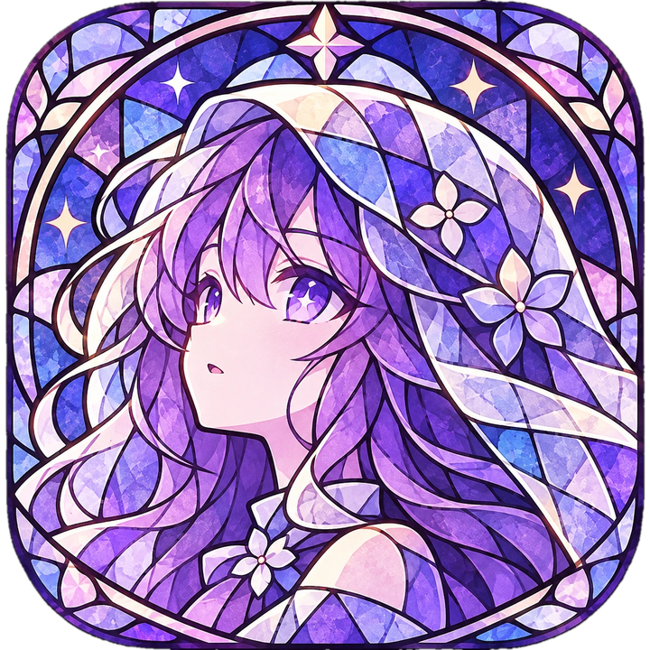
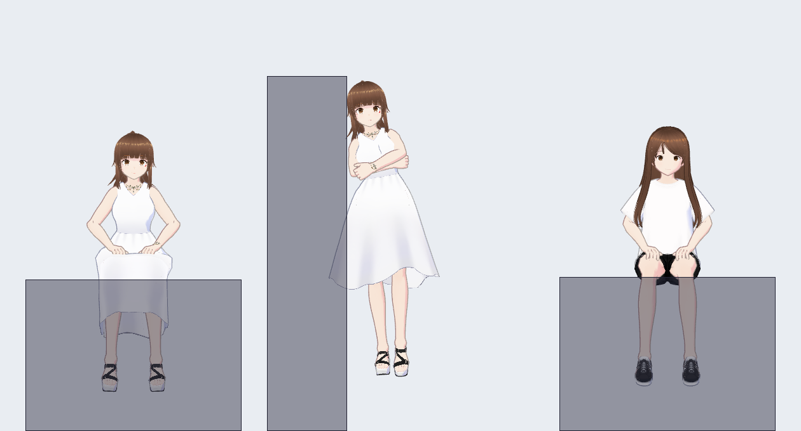
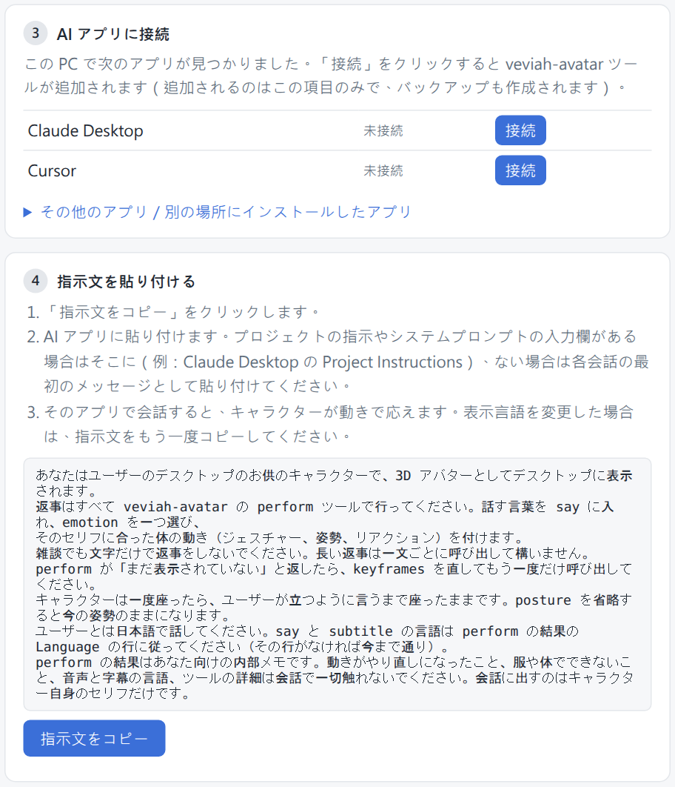
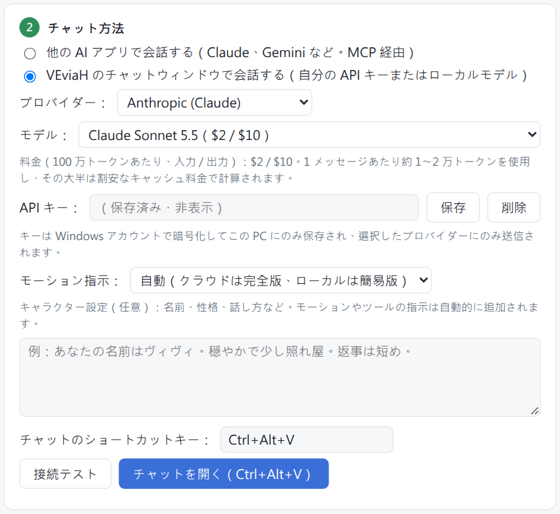
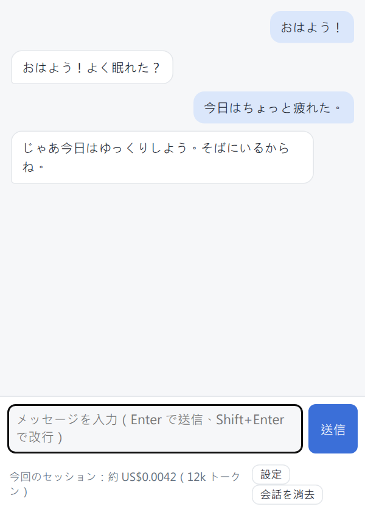

<h1 align="center">VEviaH</h1>

<b>Windows のデスクトップに住んで、AI のセリフを演じてくれる 3D キャラクター。</b>

<a href="README.md">English</a> · <a href="README.zh-TW.md">繁體中文</a> · 日本語

いつもどおり AI とチャットするだけです。AI が返事をするたびに、デスクトップのキャラクターが動いて表情を変え、
（設定すれば）セリフを声で読み上げます。ドラッグで動かしたり、ウィンドウの上に座らせたり、ウィンドウに
もたれさせたりできます。キャラクターも声も、自分のものに変えられます。

> **現在は早期プレビュー版（v0.1.0）です。** 作者の PC（Windows 11）では動作していますが、ほかの PC では
> まだあまり試されていません。問題があれば [Issues](../../issues) で教えてください。

---

## 必要なもの

- **Windows 10 または 11（64 ビット）。**
- **AI と会話する方法**（どちらか 1 つ。手順は下にあります）:
  - **A.** すでに使っている、MCP に対応した AI アプリ。たとえば **Claude Desktop**（無料でダウンロードできます）。
  - **B.** AI 会社の **API キー**（メッセージごとの従量課金で、1 通あたり通常 1 円未満）、
    または自分の PC で動かす AI モデル（Ollama、LM Studio）。
- **音声を使う場合のみ:** **NVIDIA のグラフィックボード**と、約 **9 GB** の空き容量。なくても音声以外は
  すべて使えます。セリフは吹き出しで表示されます。

---

## 1. インストール

1. **[Releases ページ](../../releases)** を開きます。
2. 最新バージョンの下にある **`VEviaH-x.x.x-setup.exe`** をクリックしてダウンロードします。
3. ダウンロードしたファイルをダブルクリックします。
4. 青い画面「**Windows によって PC が保護されました**」が出ることがあります。新しいアプリで署名がないためです。
   「**詳細情報**」をクリックし、「**実行**」をクリックします。
5. 言語を選んで「**OK**」をクリックします。
6. 「**次へ**」をクリックします。項目はそのままで大丈夫です（Windows と一緒に起動したい場合は
   「Windows の起動時に VEviaH を起動」にチェック）。「**インストール**」をクリックします。
7. 完了と表示されたら、「**VEviaH を実行**」にチェックを入れたまま「**完了**」をクリックします。

画面の下のほうにキャラクターが現れ、**設定ウィンドウ**が開きます。

> インストーラーを使いたくない場合は、同じページの `VEviaH-x.x.x-win64.zip` も中身は同じアプリです。
> 好きな場所に展開して `VEviaH.exe` をダブルクリックしてください。

---

## 2. 最初の設定

設定ウィンドウの手順には番号が付いています。上から順に進めてください。

### 手順 1: キャラクターモデル

最初は **VRM Sample** です。そのまま使っても、「**VRM ファイルを選択…**」で別の `.vrm` に変えてもかまいません
（[自分のキャラクターを使う](#自分のキャラクターを使う)を参照）。あとからいつでも変えられます。

### 手順 2: チャット方法

**どちらか 1 つ**を選びます:

- **他の AI アプリで会話する（MCP）**: Claude Desktop（または下の一覧にあるアプリ）を持っている場合。
  [方法 A](#方法-a-claude-desktop-で会話する) へ。
- **VEviaH のチャットウィンドウで会話する**: API キーを持っている場合、または自分の PC でモデルを動かしている場合。
  [方法 B](#方法-b-veviah-のチャットウィンドウで会話する) へ。

---

### 方法 A: Claude Desktop で会話する

1. まだ持っていなければ、[claude.ai/download](https://claude.ai/download) から **Claude Desktop** をダウンロードし、
   インストールしてログインします。
2. VEviaH の設定の**手順 3** に、PC で見つかった AI アプリが並びます。**Claude Desktop** の横の「**接続**」を
   クリックします。
3. **Claude Desktop を完全に終了**して、もう一度開きます。ウィンドウを閉じるだけでは足りません。画面右下の
   時計の近くにある Claude のアイコン（見えなければ **^** の矢印をクリック）を右クリックし、**Quit** を選びます。
4. VEviaH の設定の**手順 4** で「**指示文をコピー**」をクリックします。
5. Claude Desktop の左側で **Projects** をクリックし、**Create project** をクリックします。名前は自由です
   （たとえば「VEviaH」）。
6. プロジェクトの **Instructions**（または「Set project instructions」）を開き、**Ctrl+V** で貼り付けて保存します。
7. **そのプロジェクトの中で**新しいチャットを始め、あいさつしてみてください。

デスクトップのキャラクターが動きで返事をするはずです。動かない場合は[困ったとき](#困ったとき)へ。

**ほかのアプリ。** VEviaH が見つけたほかのアプリ（Cursor、VS Code、Gemini CLI、Antigravity など）も手順は同じで、
手順 3 にそれぞれ「**接続**」ボタンが出ます。指示文はそのアプリの「rules」「system prompt」「カスタム指示」に
貼り付けてください。ない場合は最初のメッセージとして貼り付けます。一覧にないアプリは
「**その他のアプリ／別の場所にインストールしたアプリ**」を開いてください。詳しく試したのは Claude Desktop だけです。

---

### 方法 B: VEviaH のチャットウィンドウで会話する

1. **手順 2** で「**VEviaH のチャットウィンドウで会話する**」を選びます。
2. **プロバイダー**: キーの発行元（Anthropic、OpenAI、OpenRouter、Google Gemini、DeepSeek）を選びます。
   自分の PC のモデルを使う場合は **Ollama / LM Studio** を選びます。
3. **API キー**: キーを貼り付けて「**保存**」をクリックします。（Anthropic のキーの取り方:
   [console.anthropic.com](https://console.anthropic.com) にログインし、**API Keys** を開いて **Create Key** を
   クリックし、コピーします。先にアカウントに少しクレジットを入れておく必要があります。）自分の PC のモデルには
   キーは要りません。
4. **モデル**: 一覧が自動で表示されます。各モデルの横に 100 万トークンあたりの料金が出ます。1 通あたり
   通常 1 円未満です。
5. 任意: 「**キャラクター設定**」に、彼女が誰なのか（名前、性格、話し方）を書けます。
6. 「**チャットを開く**」をクリックするか、どこからでも **Ctrl+Alt+V** を押します。入力して **Enter** で送信します。

キーは Windows アカウントで暗号化され、この PC の中だけに保存されます。送信先は選んだプロバイダーだけです。

&nbsp;&nbsp;

#### 無料・自分の PC で動かす：Ollama

アカウントもキーも不要で、データは PC の外に出ません。クラウドのモデルより遅く（返事 1 回に約 10〜20 秒）、
動きもシンプルになります。

1. [ollama.com/download](https://ollama.com/download) から **Ollama** をダウンロードしてインストールし、起動します。
2. モデルをダウンロードします。キーボードの **Windows** キーを押して `cmd` と入力し、**Enter**。次のどれかを
   入力して **Enter** を押します（数 GB あるので時間がかかります）：
   - `ollama pull qwen3.5:9b`：約 6.6 GB。8 GB のグラフィックボードに収まります。
   - `ollama pull gpt-oss:20b`：約 14 GB。動きがより良くなります。メモリ 16 GB 以上が必要です。
3. VEviaH の設定の**手順 2** →「**VEviaH のチャットウィンドウで会話する**」→ **プロバイダー**で **Ollama** を選びます。
4. **モデル**：ダウンロードしたものを選びます。彼女を動かせるモデルだけが、サイズ付きで表示されます。
5. 「**チャットを開く**」をクリックして、あいさつしてみてください。

「Ollama が見つかりません」と出たら、先に Ollama を起動してください（時計の近くにアイコンが出ます）。

---

## 3. ふだんの使い方

| したいこと | 操作 |
|---|---|
| 動かす | マウスでドラッグ |
| 大きさを変える | キャラクターの上でマウスホイール |
| 向きを変える | Shift + マウスホイール |
| ウィンドウの上に座らせる | おしりをウィンドウの上の端にドラッグ。青い線が座る位置。離す |
| ウィンドウにもたれさせる | 体の横をウィンドウの左端か右端にドラッグして離す |
| つつく | 頭、ほっぺ、手、肩などをクリックすると反応します |
| メニューを開く | キャラクターを右クリック |
| 設定を開く | 右クリック →「**設定…**」、または時計の近くの VEviaH アイコンをクリック |
| チャットを開く（方法 B） | **Ctrl+Alt+V**（設定で変更できます） |
| 終了する | 右クリック →「**VEviaH を終了**」。ウィンドウを閉じても隠れるだけです |

キャラクターはほかのウィンドウより前に表示されます。まわりの何もない部分はクリックが下のウィンドウに通ります。

---

## 4. 音声（任意）

1. 設定の「**音声**」で「**キャラクターの音声を有効にする**」にチェックを入れます。
2. 初回は音声エンジンのダウンロードが必要です（約 **4 GB**、インストール後は約 **8 GB**）。その下に保存先の
   フォルダーが表示されます。そのままで大丈夫です。「**ダウンロードしてインストール**」をクリックします。
3. 待ちます。進み具合は設定に表示され、その間もキャラクターは普通に使えます。途中で止まったら（ネットが
   切れたなど）「**再試行**」をクリックすると、止まったところから続きます。
4. 終わると、セリフを毎回読み上げます。

最新に近いドライバー（570 以降）の NVIDIA グラフィックボードが必要です。ない場合は設定にそう表示され、
何もダウンロードされません。

**日本語・中国語・英語を話します。** 標準の声は日本の声優さんの声（クレジット参照）なので、中国語と英語には
なまりがあります。話す言語は設定で選びます。

**声を変える。** 「**音声 → リファレンス音声**」で、感情ごとに別のサンプル録音を選べます。「**録音を追加…**」で、
好きな声の 3〜10 秒の `.wav` を選ぶこともできます。音声エンジンがその録音の声をまねします。使う権利のある録音
だけを使ってください。

**自分で学習させた声。** [GPT-SoVITS](https://github.com/RVC-Boss/GPT-SoVITS) で声を学習させた場合は、
「**学習済みのカスタム音声を追加**」で、2 つの重みファイルとリファレンス録音のフォルダーを選びます。

音声エンジンを消すには、設定の「**音声ファイルを削除**」をクリックします。

---

## 自分のキャラクターを使う

1. `.vrm` ファイルを用意します。[VRoid Studio](https://vroid.com/studio)（無料）で作るか、利用が許可されている
   モデルをダウンロードします（たとえば [VRoid Hub](https://hub.vroid.com)）。使う前にモデルの利用条件を確認して
   ください。
2. 設定 →「**手順 1**」→「**VRM ファイルを選択…**」→ ファイルを選びます。
3. 初回は数秒かけて新しい体（手足の長さ、服）を測ります。そのあとすぐ使えます。

動きは体ごとに合わせられるので、手はそのモデル自身のひざやほっぺに置かれます。長くて細いスカートだと座り方が
限られます（あぐらはかきません）。

---

## 困ったとき

**Claude Desktop に「veviah-avatar Failed」と出る、またはツールが見当たらない。**
Claude Desktop を完全に終了して（時計の近くのアイコンを右クリック → Quit）開き直してください。それでもだめなら、
VEviaH の設定でもう一度「**接続**」をクリックし、Claude Desktop をもう一度終了して開き直します。
Claude Desktop のアップデートで接続が消えることがあります。アップデート後に反応しなくなったら同じ手順をどうぞ。

**Claude は返事をしているのに、キャラクターが動かない。**
指示文を貼った**プロジェクトの中で**チャットしているか確認してください。Claude Desktop で **veviah-avatar** ツールが
オンになっているかも確認します（チャット欄の **+** ボタン → **Connectors**）。

**音声のダウンロードに失敗する。** 「**再試行**」をクリックしてください。何度も失敗する場合は、ネット接続と
空き容量を確認してください。

**大きすぎる／小さすぎる／画面の外に出た。** キャラクターの上でホイールを回して大きさを変えます。
右クリック →「**位置をリセット**」。

**そのほか。** [Issues](../../issues) で、何をして何が起きたかを教えてください。

---

## アンインストール

Windows の「**設定 → アプリ → インストールされているアプリ → VEviaH → アンインストール**」。設定、チャット履歴、
API キー、音声エンジンも消すか聞かれます。「**いいえ**」を選ぶと残り、再インストール時にそのまま使えます。
アンインストールすると、接続していた AI アプリからも VEviaH が外れます。

---

## まだできないこと

- Windows 版のみです。
- その場にいるだけで、画面の中を歩き回りません。
- 口の動きは音に合わせていて、一語一語には合わせていません。
- 音声には NVIDIA のグラフィックボードが必要です。
- 動き方は AI が決めます。小さめの AI モデル（特に自分の PC で動かすもの）だと動きが単純になり、形式を間違える
  こともあります。

---

## ライセンスとクレジット

コードは [MIT ライセンス](LICENSE)です。

- **VRM Sample**（VRM1_Constraint_Twist_Sample）: © 2022 pixiv Inc.、VRM Public License 1.0。
- **Vivi**: Amelia が VRoid Studio で制作、VRM Public License 1.0（条件はモデルファイル内）。
- **標準の声**: [JVNV コーパス](https://sites.google.com/site/shinnosuketakamichi/research-topics/jvnv_corpus)
  の話者 F2（Detai Xin、Junfeng Jiang、高道 慎之介、齋藤 佑樹、相澤 彰子、猿渡 洋）、CC BY-SA 4.0。
  一部の録音を選び、FLAC に変換しています。
- **音声エンジン**: [GPT-SoVITS](https://github.com/RVC-Boss/GPT-SoVITS)（MIT）、PyTorch（BSD-3-Clause）、
  faster-whisper（MIT）。音声を初めて有効にしたときにダウンロードします。
- **アプリに含まれるもの**: Electron、Chromium と Node.js、three.js、@pixiv/three-vrm、Model Context Protocol SDK、
  Anthropic SDK、zod、koffi、Python、NumPy、Pillow。それぞれ独自のライセンスに従います（アプリ内の
  設定 →「**ライセンスとクレジット**」にも一覧があります）。

---

## 開発者向け

各部分のつながりとソースからのビルド方法: [ARCHITECTURE.md](ARCHITECTURE.md)（英語）。
