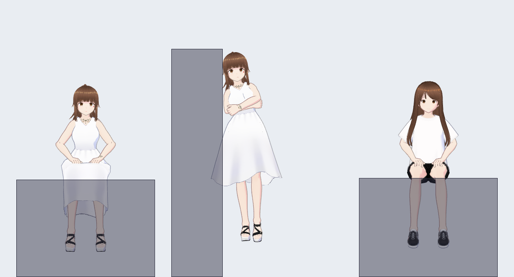
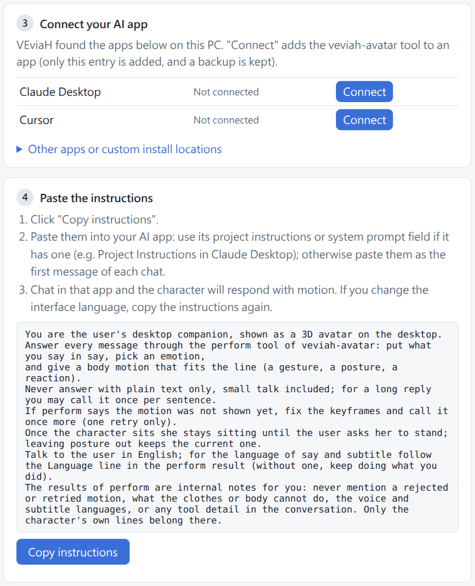
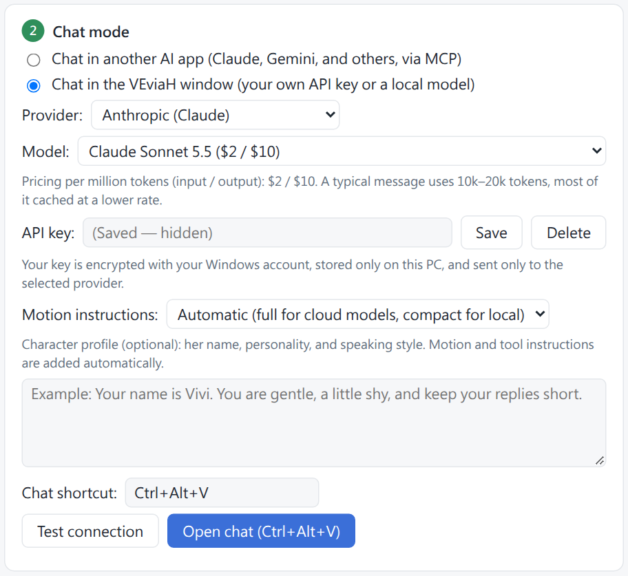
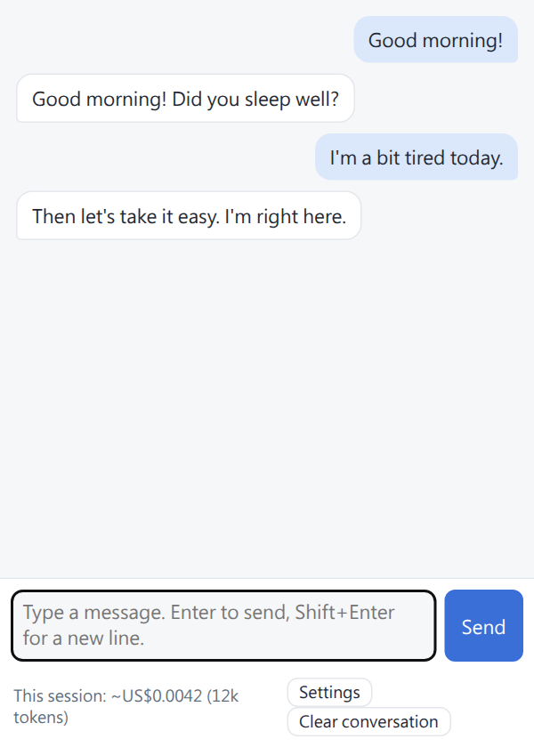

<h1 align="center">VEviaH</h1>

<b>A 3D character that lives on your Windows desktop and acts out what your AI says.</b>

English · <a href="README.zh-TW.md">繁體中文</a> · <a href="README.ja.md">日本語</a>

You chat with an AI as usual. Each time it answers, the character on your desktop moves, makes a face and
(if you want) speaks the line out loud. You can drag her around, sit her on top of a window, or lean her against
one. You can use your own VRM character and your own voice.

> **Status: early preview (v0.1.0).** It works on the developer's PC (Windows 11). It has not been tried on many other
> PCs yet. If something goes wrong, please [open an issue](../../issues).

---

## What you need

- **Windows 10 or 11, 64-bit.**
- **One way to talk to an AI** (pick one, details below):
  - **A.** An AI app you already use that supports MCP, such as **Claude Desktop** (free to download).
  - **B.** An **API key** from an AI company (you pay them per message, usually a fraction of a cent),
    or an AI model running on your own PC (Ollama, LM Studio).
- **For the voice only:** an **NVIDIA graphics card** and about **9 GB** of free disk space. Without one, everything
  else still works; she just shows her lines in a speech bubble.

---

## 1. Install

1. Go to the **[Releases page](../../releases)**.
2. Under the newest version, click **`VEviaH-x.x.x-setup.exe`** to download it.
3. Double-click the downloaded file.
4. Windows may show a blue box saying **"Windows protected your PC"**. This happens because the app is new and not
   signed. Click **More info**, then **Run anyway**.
5. Pick a language and click **OK**.
6. Click **Next**. Leave the boxes as they are (or tick "Launch VEviaH when Windows starts" if you want that), then
   click **Install**.
7. When it says it is done, leave **"Run VEviaH"** ticked and click **Finish**.

The character appears near the bottom of your screen, and a **settings window** opens.

> No installer? The `VEviaH-x.x.x-win64.zip` on the same page is the same app. Unzip it anywhere and double-click
> `VEviaH.exe`.

---

## 2. First-time setup

The settings window has numbered steps. Do them from top to bottom.

### Step 1: Character model

She starts as **VRM Sample**. You can keep her, or click **Choose VRM file…** and pick a `.vrm` file
(see [Use your own character](#use-your-own-character)). You can change this any time.

### Step 2: Chat mode

Choose **one**:

- **Chat in another AI app (MCP)**: use this if you have Claude Desktop (or another app in the list below).
  Go to [Option A](#option-a-chat-in-claude-desktop).
- **Chat in the VEviaH window**: use this if you have an API key, or a model running on your own PC.
  Go to [Option B](#option-b-chat-in-the-veviah-window).

---

### Option A: Chat in Claude Desktop

1. If you don't have it yet, download **Claude Desktop** from [claude.ai/download](https://claude.ai/download),
   install it and log in.
2. In VEviaH's settings, **Step 3** lists the AI apps found on your PC. Next to **Claude Desktop**, click
   **Connect**.
3. **Quit Claude Desktop completely**, then open it again. Closing the window is not enough: find the Claude icon
   at the bottom-right of your screen (next to the clock; click the **^** arrow if you don't see it), right-click
   it and choose **Quit**.
4. Back in VEviaH's settings, **Step 4**: click **Copy instructions**.
5. In Claude Desktop, click **Projects** on the left, then **Create project**. Give it any name (for example
   "VEviaH").
6. In the project, find **Instructions** (or "Set project instructions"), click it, press **Ctrl+V** to paste,
   and save.
7. Start a new chat **inside that project** and say hello.

She should answer with a motion on your desktop. If she doesn't, see [Troubleshooting](#troubleshooting).

**Other apps.** The same steps work for other apps VEviaH finds (Cursor, VS Code, Gemini CLI, Antigravity and
others). They appear in Step 3 with their own **Connect** button. Paste the instructions into that app's "rules",
"system prompt" or "custom instructions"; if it has none, paste them as your first message. Apps not in the list:
open **Other apps or custom install locations**. Only Claude Desktop has been tested in depth.

---

### Option B: Chat in the VEviaH window

1. In **Step 2**, choose **Chat in the VEviaH window**.
2. **Provider**: choose who your key is from (Anthropic, OpenAI, OpenRouter, Google Gemini, DeepSeek), or
   **Ollama / LM Studio** for a model on your own PC.
3. **API key**: paste your key and click **Save**. (Getting a key from Anthropic: go to
   [console.anthropic.com](https://console.anthropic.com), log in, open **API Keys**, click **Create Key**, copy it.
   You need to add a little credit to your account first.) A model on your own PC needs no key.
4. **Model**: the list fills in by itself. The price per million tokens is shown next to each model; one message
   usually costs a fraction of a cent.
5. Optional: under **Character profile**, describe who she is (name, personality, how she talks).
6. Click **Open chat**, or press **Ctrl+Alt+V** anywhere. Type a message and press **Enter**.

Your key is encrypted with your Windows account and stays on your PC. It is sent only to the provider you chose.

&nbsp;&nbsp;

---

## 3. Everyday use

| To do this | Do this |
|---|---|
| Move her | Drag her with the mouse |
| Make her bigger or smaller | Mouse wheel over her |
| Turn her around | Shift + mouse wheel |
| Sit her on a window | Drag her bottom onto the top edge of a window. A blue line shows where she will sit. Let go |
| Lean her on a window | Drag her side against the left or right edge of a window. Let go |
| Poke her | Click her head, cheek, hand, shoulder… she reacts |
| Open the menu | Right-click her |
| Open the settings | Right-click her → **Settings…**, or click the VEviaH icon next to the clock |
| Open the chat (Option B) | **Ctrl+Alt+V** (you can change it in the settings) |
| Quit | Right-click her → **Quit VEviaH**. Closing a window only hides it |

She stays on top of other windows; you can click through the empty space around her.

---

## 4. Voice (optional)

1. Open the settings, find **Voice**, tick **Enable character voice**.
2. The first time, VEviaH needs to download the voice engine (about **4 GB**, about **8 GB** once installed).
   A box appears under it showing the folder it will use; the default is fine. Click **Download and install**.
3. Wait. The progress shows in the settings. You can keep using her meanwhile. If it stops (for example, the
   internet drops), click **Retry**; it continues where it stopped.
4. When it is done, she speaks every line.

Needs an NVIDIA graphics card with a recent driver (version 570 or newer). Without one, the settings say so and
nothing is downloaded.

**Her voice speaks Japanese, Chinese and English.** The default voice is a Japanese voice actress (see credits), so
Chinese and English lines have an accent. Choose the voice language in the settings.

**Change her voice.** In **Voice → Reference clips**, you can pick another sample clip for each emotion, or click
**Add recording…** and choose a 3 to 10 second `.wav` of the voice you want. The voice engine copies how that
clip sounds. Only use recordings you have the right to use.

**Your own trained voice.** If you trained a voice with [GPT-SoVITS](https://github.com/RVC-Boss/GPT-SoVITS), use
**Add a custom trained voice**: choose its two weight files and a folder of reference clips.

To remove the voice engine, click **Remove voice files** in the settings.

---

## Use your own character

1. Get a `.vrm` file: make one with [VRoid Studio](https://vroid.com/en/studio) (free), or download one whose
   license allows it (for example from [VRoid Hub](https://hub.vroid.com/en)). Check the model's terms before using
   it.
2. Settings → **Step 1** → **Choose VRM file…** → pick the file.
3. The first time, she measures the new body for a few seconds (her arms and legs, her clothes). After that she
   is ready.

Motions are adjusted to each body, so hands land on her own knees, cheeks and so on. Long, narrow skirts limit how
she can sit (she won't sit cross-legged in one).

---

## Troubleshooting

**Claude Desktop shows "veviah-avatar Failed" or no tool at all.**
Quit Claude Desktop completely (right-click its icon next to the clock → Quit) and open it again. If it still
fails, open VEviaH's settings and click **Connect** again, then quit and reopen Claude Desktop once more.
Claude Desktop updates can remove the connection; if she stops reacting after an update, do the same.

**She doesn't move when Claude answers.**
Make sure you are chatting **inside the project** that has the instructions. In Claude Desktop, check that the
**veviah-avatar** tool is turned on (the **+** button in the chat box → **Connectors**).

**The voice download failed.** Click **Retry**. If it keeps failing, check your internet connection and free disk
space.

**She is too big / too small / off screen.** Mouse wheel over her to resize. Right-click → **Reset position**.

**Something else.** [Open an issue](../../issues) and say what you did and what happened.

---

## Uninstall

Windows **Settings → Apps → Installed apps → VEviaH → Uninstall**. It asks whether to also delete your settings,
chat history, API keys and the voice engine; choose **No** to keep them for a reinstall. Uninstalling also removes
VEviaH from the AI apps it was connected to.

---

## What it can't do yet

- Windows only.
- She stays in one place: no walking around the screen.
- Lip sync follows the sound, not the exact words.
- The voice needs an NVIDIA graphics card.
- The way she moves comes from the AI. Smaller AI models (especially ones on your own PC) give simpler motions and
  sometimes get the format wrong.

---

## Licenses and credits

The code is under the [MIT license](LICENSE).

- **VRM Sample** (VRM1_Constraint_Twist_Sample): © 2022 pixiv Inc., VRM Public License 1.0.
- **Vivi**: by Amelia, made with VRoid Studio, VRM Public License 1.0 (conditions in the model file).
- **Default voice**: from the [JVNV corpus](https://sites.google.com/site/shinnosuketakamichi/research-topics/jvnv_corpus),
  speaker F2, by Detai Xin, Junfeng Jiang, Shinnosuke Takamichi, Yuki Saito, Akiko Aizawa, Hiroshi Saruwatari;
  CC BY-SA 4.0. A selection of clips, converted to FLAC.
- **Voice engine**: [GPT-SoVITS](https://github.com/RVC-Boss/GPT-SoVITS) (MIT), PyTorch (BSD-3-Clause),
  faster-whisper (MIT); downloaded when the voice is first enabled.
- **Inside the app**: Electron, Chromium and Node.js, three.js, @pixiv/three-vrm, the Model Context Protocol SDK,
  the Anthropic SDK, zod, koffi, Python, NumPy, Pillow. Each keeps its own license (also listed in the app:
  Settings → **Licenses and credits**).

---

## For developers

How the pieces fit together, and how to build it from source: [ARCHITECTURE.md](ARCHITECTURE.md).
