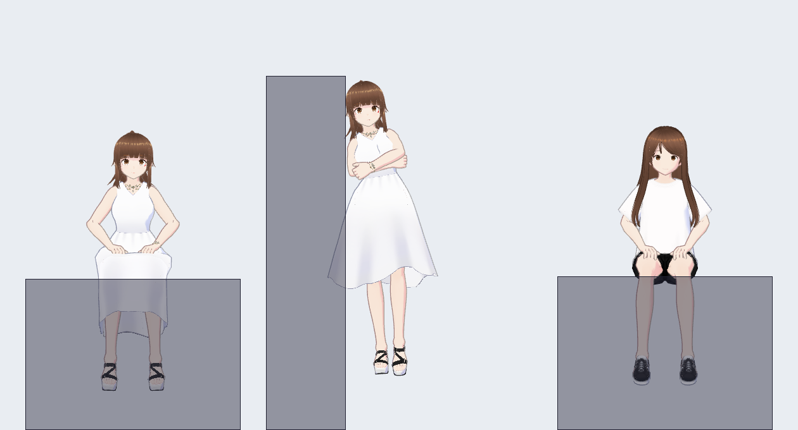
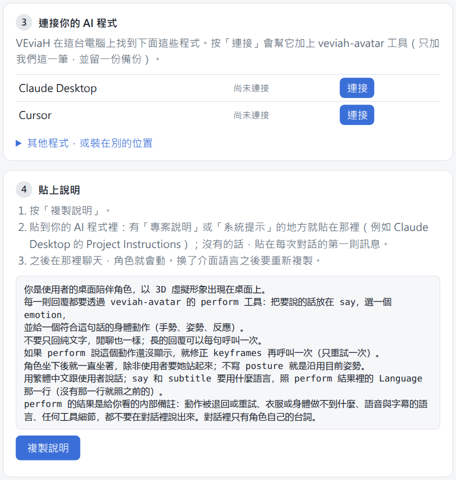
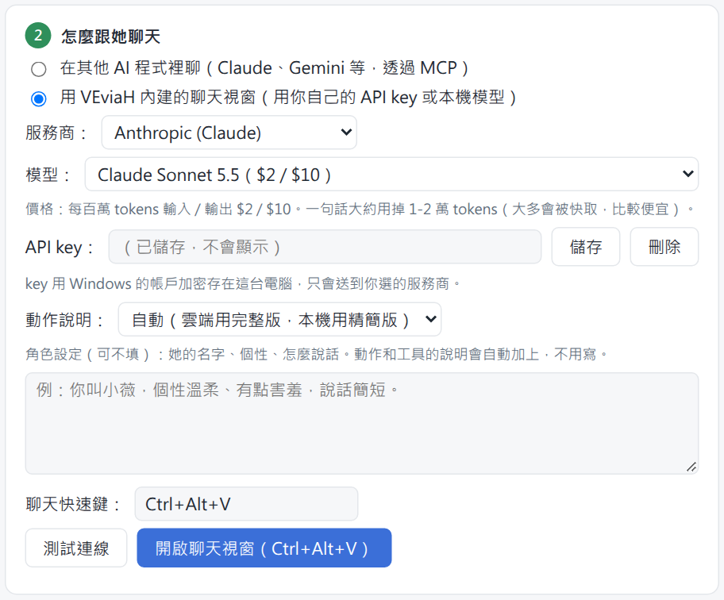
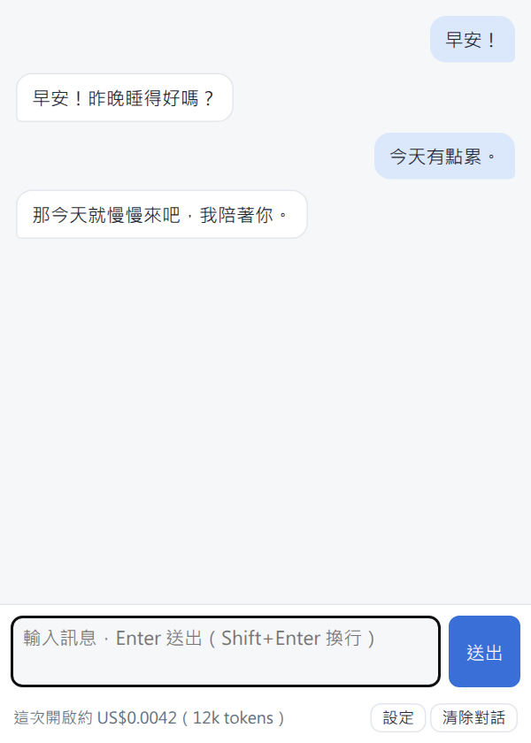

<h1 align="center">VEviaH</h1>

<b>住在 Windows 桌面上的 3D 角色，會把 AI 說的話演出來。</b>

<a href="README.md">English</a> · 繁體中文 · <a href="README.ja.md">日本語</a>

你照平常那樣跟 AI 聊天。AI 每回一句話，桌面上的角色就會跟著做動作、做表情，也可以把那句話念出來。你可以拖著她走、
讓她坐在視窗上面、或靠在視窗旁邊。角色和聲音都可以換成你自己的。

> **目前是早期預覽版（v0.1.0）。** 在作者的電腦（Windows 11）上能正常使用，還沒在很多別的電腦上試過。
> 遇到問題請到 [Issues](../../issues) 回報。

---

## 需要什麼

- **Windows 10 或 11（64 位元）。**
- **一個跟 AI 聊天的方法**（二選一，下面有詳細步驟）：
  - **A.** 你本來就在用、支援 MCP 的 AI 程式，例如 **Claude Desktop**（免費下載）。
  - **B.** AI 公司的 **API key**（每則訊息按用量付錢，通常一則不到一塊台幣），
    或在自己電腦上跑的 AI 模型（Ollama、LM Studio）。
- **只有語音需要：** **NVIDIA 顯示卡**，和大約 **9 GB** 的硬碟空間。沒有的話其他功能都能用，
  她會把台詞顯示在對話框裡。

---

## 1. 安裝

1. 打開 **[Releases 頁面](../../releases)**。
2. 在最新版本底下，點 **`VEviaH-x.x.x-setup.exe`** 下載。
3. 雙擊下載好的檔案。
4. Windows 可能會跳出藍色視窗「**Windows 已保護您的電腦**」。這是因為這個程式很新、沒有數位簽章。
   點「**其他資訊**」，再點「**仍要執行**」。
5. 選語言，按「**確定**」。
6. 按「**下一步**」。選項維持原樣就好（想開機自動啟動的話，勾「Windows 開機時啟動 VEviaH」），再按「**安裝**」。
7. 顯示安裝完成後，保持「**執行 VEviaH**」打勾，按「**完成**」。

角色會出現在螢幕下方，同時跳出**設定視窗**。

> 不想用安裝程式？同一頁的 `VEviaH-x.x.x-win64.zip` 是同一個程式。解壓縮到任何地方，雙擊 `VEviaH.exe` 就行。

---

## 2. 第一次設定

設定視窗裡的步驟有編號，從上往下做。

### 步驟 1：角色模型

一開始是 **VRM Sample**。可以直接用，也可以按「**選擇 VRM 檔…**」換成別的 `.vrm` 檔
（見[換成你自己的角色](#換成你自己的角色)）。之後隨時都能換。

### 步驟 2：怎麼跟她聊天

**二選一**：

- **在其他 AI 程式裡聊（MCP）**：你有 Claude Desktop（或下面列的其他程式）就選這個。
  接著看 [方法 A](#方法-a在-claude-desktop-裡聊)。
- **用 VEviaH 內建的聊天視窗**：你有 API key，或自己電腦上有跑模型就選這個。
  接著看 [方法 B](#方法-b用-veviah-的聊天視窗)。

---

### 方法 A：在 Claude Desktop 裡聊

1. 還沒有的話，到 [claude.ai/download](https://claude.ai/download) 下載 **Claude Desktop**，安裝並登入。
2. 在 VEviaH 設定的**步驟 3**，會列出你電腦上找到的 AI 程式。在 **Claude Desktop** 旁邊按「**連接**」。
3. **把 Claude Desktop 完全關掉**，再重新打開。只關視窗不算：在螢幕右下角時鐘旁邊找到 Claude 的圖示
   （看不到的話點 **^** 小箭頭），按右鍵選 **Quit**。
4. 回到 VEviaH 設定的**步驟 4**，按「**複製說明**」。
5. 在 Claude Desktop 左邊點 **Projects**，再點 **Create project**。名字隨便取（例如「VEviaH」）。
6. 在專案裡找到 **Instructions**（或「Set project instructions」），點進去，按 **Ctrl+V** 貼上，然後儲存。
7. **在這個專案裡**開一個新對話，跟她打招呼。

她應該會在桌面上用動作回應你。沒反應的話看[常見問題](#常見問題)。

**其他程式。** VEviaH 找到的其他程式（Cursor、VS Code、Gemini CLI、Antigravity 等）步驟一樣，
在步驟 3 有各自的「**連接**」按鈕。說明要貼到那個程式的「rules」、「system prompt」或「自訂指示」；
都沒有的話，就當成第一則訊息貼上。不在清單裡的程式：打開「**其他程式，或裝在別的位置**」。
目前只有 Claude Desktop 經過完整測試。

---

### 方法 B：用 VEviaH 的聊天視窗

1. 在**步驟 2** 選「**用 VEviaH 內建的聊天視窗**」。
2. **服務商**：選你的 key 是哪家的（Anthropic、OpenAI、OpenRouter、Google Gemini、DeepSeek），
   或選 **Ollama / LM Studio** 用自己電腦上的模型。
3. **API key**：貼上 key，按「**儲存**」。（跟 Anthropic 拿 key：到
   [console.anthropic.com](https://console.anthropic.com) 登入，打開 **API Keys**，按 **Create Key**，複製。
   要先在帳號裡儲值一點錢。）自己電腦上的模型不用 key。
4. **模型**：清單會自己出現。每個模型旁邊標了每百萬 token 的價格，一則訊息通常不到一塊台幣。
5. 可以不填：在「**角色設定**」寫她是誰（名字、個性、說話方式）。
6. 按「**開啟聊天視窗**」，或在任何地方按 **Ctrl+Alt+V**。打字後按 **Enter** 送出。

你的 key 用 Windows 帳號加密，只存在你的電腦上，只會傳給你選的服務商。

&nbsp;&nbsp;

#### 免費、在自己電腦上跑：Ollama

不用帳號、不用 key，資料不會離開你的電腦。比雲端模型慢（每次回覆大約 10～20 秒），動作也比較簡單。

1. 到 [ollama.com/download](https://ollama.com/download) 下載 **Ollama**，安裝後打開。
2. 下載模型。按鍵盤的 **Windows** 鍵，輸入 `cmd`，按 **Enter**，再輸入下面其中一行，按 **Enter**
   （要下載好幾 GB，會等一陣子）：
   - `ollama pull qwen3.5:9b`：約 6.6 GB，8 GB 顯示卡放得下。
   - `ollama pull gpt-oss:20b`：約 14 GB，動作比較好；記憶體要 16 GB 以上。
3. VEviaH 設定的**步驟 2** →「**用 VEviaH 內建的聊天視窗**」→ **服務商**選 **Ollama**。
4. **模型**：選你剛下載的那個。清單只會列出能讓她動起來的模型，旁邊標了大小。
5. 按「**開啟聊天視窗**」，跟她打招呼。

如果顯示「找不到 Ollama」，先打開 Ollama（時鐘旁邊會出現它的圖示）。

---

## 3. 平常怎麼用

| 想做什麼 | 怎麼做 |
|---|---|
| 移動她 | 用滑鼠拖 |
| 放大縮小 | 在她身上滾滑鼠滾輪 |
| 讓她轉身 | Shift + 滾輪 |
| 讓她坐在視窗上 | 把她的屁股拖到某個視窗的上緣，出現藍線就是她會坐的位置，放開 |
| 讓她靠著視窗 | 把她的側邊拖到某個視窗的左邊或右邊，放開 |
| 戳她 | 點她的頭、臉頰、手、肩膀……她會有反應 |
| 打開選單 | 在她身上按右鍵 |
| 打開設定 | 右鍵 →「**設定…**」，或點時鐘旁邊的 VEviaH 圖示 |
| 打開聊天視窗（方法 B） | **Ctrl+Alt+V**（可以在設定裡改） |
| 結束 | 右鍵 →「**結束 VEviaH**」。關掉視窗只是把它藏起來 |

她會一直在其他視窗上面；她周圍空白的地方可以直接點穿過去。

---

## 4. 語音（可以不開）

1. 打開設定，找到「**語音**」，勾「**角色開口說話**」。
2. 第一次要下載語音引擎（約 **4 GB**，裝好後約 **8 GB**）。下面會出現一個框，顯示要裝在哪個資料夾，
   用預設的就好。按「**下載安裝**」。
3. 等它下載。進度會顯示在設定裡，這段時間她照常可以用。如果中途斷掉（例如網路斷了），按「**重試**」，
   會從斷掉的地方接著下載。
4. 裝好之後，她每句台詞都會念出來。

需要 NVIDIA 顯示卡，驅動程式要夠新（570 版以上）。沒有的話設定裡會說明，什麼都不會下載。

**她會說日文、中文和英文。** 預設聲音來自一位日本配音員（見致謝），所以說中文和英文會有口音。
語音的語言在設定裡選。

**換她的聲音。** 在「**語音 → 參考音**」裡，每種情緒都可以換一段範例錄音，或按「**加入錄音…**」選一段
3 到 10 秒、你想要的聲音的 `.wav` 檔。語音引擎會模仿那段錄音的聲音。只用你有權使用的錄音。

**你自己訓練的聲音。** 如果你用 [GPT-SoVITS](https://github.com/RVC-Boss/GPT-SoVITS) 訓練過聲音，
用「**加入我自己訓練的聲音**」：選它的兩個權重檔，和一個放參考錄音的資料夾。

要移除語音引擎，在設定裡按「**刪除語音檔案**」。

---

## 換成你自己的角色

1. 準備一個 `.vrm` 檔：用 [VRoid Studio](https://vroid.com/studio)（免費）自己捏，或下載授權允許使用的模型
   （例如 [VRoid Hub](https://hub.vroid.com)）。使用前先看清楚模型的使用條款。
2. 設定 →「**步驟 1**」→「**選擇 VRM 檔…**」→ 選那個檔案。
3. 第一次載入時，她會花幾秒量一下新身體（手腳長度、衣服），之後就能用了。

動作會依每個身體調整，所以手會放到她自己的膝蓋、臉頰上。又長又窄的裙子會限制她的坐姿
（例如不會盤腿坐）。

---

## 常見問題

**Claude Desktop 顯示「veviah-avatar Failed」，或根本沒有這個工具。**
把 Claude Desktop 完全關掉（時鐘旁邊的圖示按右鍵 → Quit）再打開。還是不行的話，到 VEviaH 設定再按一次
「**連接**」，然後再完全關掉、重開一次 Claude Desktop。Claude Desktop 更新後可能會把連接拿掉；
更新後她沒反應的話，也這樣做。

**Claude 回話了，她卻不動。**
確認你是在**有貼說明的那個專案裡**聊天。在 Claude Desktop 確認 **veviah-avatar** 工具是開著的
（聊天框的 **+** 按鈕 → **Connectors**）。

**語音下載失敗。** 按「**重試**」。一直失敗的話，檢查網路和硬碟剩餘空間。

**她太大、太小、或跑出螢幕外。** 在她身上滾滾輪調整大小。右鍵 →「**回到預設位置**」。

**其他問題。** 到 [Issues](../../issues) 回報，說明你做了什麼、發生了什麼。

---

## 解除安裝

Windows「**設定 → 應用程式 → 已安裝的應用程式 → VEviaH → 解除安裝**」。它會問要不要一起刪掉設定、
聊天紀錄、API key 和語音引擎；選「**否**」會保留，之後重裝可以直接用。解除安裝也會把 VEviaH
從連接過的 AI 程式裡拿掉。

---

## 目前還做不到的事

- 只有 Windows 版。
- 她待在原地，不會在螢幕上走來走去。
- 嘴型是跟著聲音動，不是照著每個字。
- 語音需要 NVIDIA 顯示卡。
- 她怎麼動是 AI 決定的。比較小的 AI 模型（特別是在自己電腦上跑的）動作比較簡單，有時格式會寫錯。

---

## 授權與致謝

程式碼採用 [MIT 授權](LICENSE)。

- **VRM Sample**（VRM1_Constraint_Twist_Sample）：© 2022 pixiv Inc.，VRM Public License 1.0。
- **Vivi**：Amelia 用 VRoid Studio 製作，VRM Public License 1.0（條件寫在模型檔裡）。
- **預設聲音**：取自 [JVNV 語料庫](https://sites.google.com/site/shinnosuketakamichi/research-topics/jvnv_corpus)
  的 F2 說話者，作者 Detai Xin、Junfeng Jiang、Shinnosuke Takamichi、Yuki Saito、Akiko Aizawa、
  Hiroshi Saruwatari；CC BY-SA 4.0。挑選了部分錄音並轉成 FLAC。
- **語音引擎**：[GPT-SoVITS](https://github.com/RVC-Boss/GPT-SoVITS)（MIT）、PyTorch（BSD-3-Clause）、
  faster-whisper（MIT）；第一次開語音時才下載。
- **程式裡用到的**：Electron、Chromium 和 Node.js、three.js、@pixiv/three-vrm、Model Context Protocol SDK、
  Anthropic SDK、zod、koffi、Python、NumPy、Pillow。各自保有自己的授權（app 裡也有列：設定 →
  「**授權與致謝**」）。

---

## 給開發者

各部分怎麼組在一起、怎麼從原始碼建置：[ARCHITECTURE.md](ARCHITECTURE.md)（英文）。
